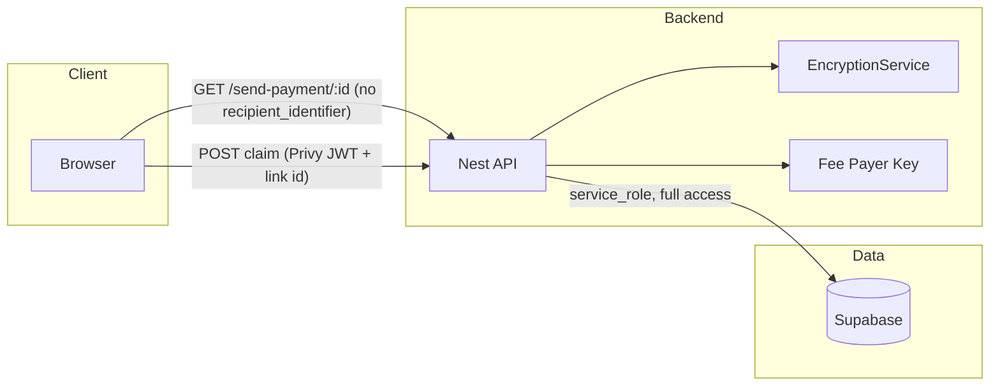

# Security and Privacy Audit: Send Payment and Supabase

## 1. Recipient data privacy: "Can someone see all claims and who can claim?"

### Current state

- **API does not expose recipient identifiers.** The only public endpoint for link data is `GET /send-payment/:id` ([send-payment.service.ts](apps/backend/src/modules/send-payment/send-payment.service.ts) lines 165–199). It explicitly selects:
  - `id, amount, token, chain, recipient_type, status, message, burner_address, sender_user_id`
  - It does **not** select or return `recipient_identifier` (email or Twitter handle). The public entity [SendPaymentLinkPublic](apps/backend/src/modules/send-payment/entities/send-payment-link.entity.ts) also has no `recipient_identifier` field.
- **No list endpoint.** There is no API that returns multiple links or a list of claims. Access is only by **link ID** (UUID). Without the link URL, an attacker cannot enumerate "all claims" or "who can claim" via the API.
- **Claim authorization.** To claim, the user must:
  1. Have the link ID (e.g. `/s/{id}`).
  2. Be authenticated via Privy.
  3. Pass [verifyRecipientIdentityForSendPayment](apps/backend/src/modules/users/users.service.ts) (lines 228–253): the Privy user’s linked accounts (email or Twitter) must match the link’s `recipient_type` and `recipient_identifier` stored in the DB. So only the designated email/Twitter can claim; no one can "see all recipients" via the API and then target them.

**Remaining risks**

- **Database and backend compromise:** `recipient_identifier` is stored in plaintext in `send_payment_links`. Anyone with DB access (Supabase dashboard, service role, backup, or backend server compromise) can read all links and their recipients. That enables targeted attacks (e.g. phishing that email/Twitter to steal the claim).
- **Recommendation:** Treat recipient data as sensitive. Prefer **encrypting `recipient_identifier` at rest** with a key derived from `SEND_PAYMENT_ENC_KEY` or a dedicated key, and decrypt only in the backend when verifying claim identity. That way a DB dump or read-only DB leak does not expose emails/Twitter handles.

---

## 2. Fee payer and encryption keys: KMS vs TEE vs MPC vs Arcium

### Current state

- **SOLANA_FEE_PAYER_PRIVATE_KEY** and **SEND_PAYMENT_ENC_KEY** are read from environment (e.g. [.env.local](apps/backend/.env.local)) via [ConfigService](apps/backend/src/app.module.ts) and used in process memory:
  - Fee payer: [send-payment.service.ts](apps/backend/src/modules/send-payment/send-payment.service.ts) (constructor, bs58 decode).
  - Enc key: [encryption.service.ts](apps/backend/src/modules/send-payment/encryption.service.ts) (constructor, AES-256-GCM for burner secrets).
- If the host or env is compromised, both keys are exposed.

### Options (high level)

| Approach                            | Pros                                                      | Cons                                                                                                                           | Fit for this stack                                                                                                                                                                                            |
| ----------------------------------- | --------------------------------------------------------- | ------------------------------------------------------------------------------------------------------------------------------ | ------------------------------------------------------------------------------------------------------------------------------------------------------------------------------------------------------------- |
| **KMS (AWS KMS / GCP KMS / etc.)**  | Key never leaves HSM; audit logs; rotation.               | Need to fetch key or decrypt per use; latency; cloud lock-in.                                                                  | Good for **SEND_PAYMENT_ENC_KEY**: backend requests decryption of a ciphertext (e.g. encrypted burner key) or derives a data key. Fee payer key can be "encrypted by KMS" and decrypted at startup or per-tx. |
| **TEE (e.g. AWS Nitro, Intel SGX)** | Code + keys run in enclave; attestation.                  | Operational complexity; still need to get key into TEE (often via KMS).                                                        | Strong if you run backend (or sensitive paths) inside a TEE and feed keys from KMS.                                                                                                                           |
| **MPC (multi-party computation)**   | Private key never exists in one place; threshold signing. | More integration work (Solana signing + AES usage); need multiple parties.                                                     | Best if you want threshold signing for the fee payer and are willing to run multiple signer nodes.                                                                                                            |
| **Arcium (formerly Elusiv)**        | Crypto/MPC-focused; Solana ecosystem.                     | Product fit is for key management / signing in dApps; need to confirm support for "backend holds key material" vs client-side. | Evaluate if they offer a **server-side** key vault or HSM-style API for Solana keys and/or symmetric keys; if yes, could replace raw env for one or both keys.                                                |

**Practical recommendation**

- **Short term:** Keep env-based keys but: (1) restrict file and process access to `.env.local` and the backend process; (2) never log or expose key material; (3) use different keys per environment (dev/staging/prod).
- **Next step (high impact):** Use **KMS** (e.g. AWS KMS or GCP KMS) to:
  - **SEND_PAYMENT_ENC_KEY:** Store a 32-byte master key encrypted by KMS; at startup (or per-request if you want no key in memory long-lived), call KMS to decrypt and feed the AES key into [SendPaymentEncryptionService](apps/backend/src/modules/send-payment/encryption.service.ts). Alternatively, use KMS to generate data keys for encrypting burner secrets (envelope encryption).
  - **SOLANA_FEE_PAYER_PRIVATE_KEY:** Store the key encrypted under KMS (or store a key-encryption-key in KMS). Backend decrypts once at startup and keeps in memory, or decrypt per signing (higher latency, better security). Prefer least privilege IAM for the backend role.
- **TEE:** Consider if you later move the backend (or a signing microservice) into a TEE and feed keys from KMS into the enclave.
- **MPC/Arcium:** Consider for fee payer if you want threshold signing and can integrate with your stack; Arcium if they offer a server-side API that fits.

---

## 3. Supabase access and data exposure

### Who accesses Supabase?

- **Backend (NestJS):** Uses **service role** key ([SupabaseService](apps/backend/src/database/supabase.service.ts): `SUPABASE_SECRET` or `SUPABASE_SERVICE_ROLE_KEY`). Service role **bypasses RLS**. So the backend can read/write all tables, including `send_payment_links` with full columns (`recipient_identifier`, `burner_encrypted_secret`, etc.).
- **Frontend (Next.js):** Only uses Supabase in **API routes** (e.g. [payments/history](apps/frontend/src/app/api/payments/history/route.ts), [claims](apps/frontend/src/app/api/claims/[id]/route.ts)) via [getSupabaseAdmin()](apps/frontend/src/lib/supabaseServer.ts), which uses the **same service role** server-side. The browser never receives the service role key.
- **Send payment links:** The frontend never talks to Supabase for send-payment data; it only calls the **Nest backend** ([BACKEND_URL](apps/frontend/src/services/api/client.ts)) for create/get/claim/reclaim. So send_payment_links are only accessed by the backend (and by frontend API routes that use admin Supabase for other features like claims/payments history, not for send_payment_links).

### RLS on send_payment_links

- [Migration](apps/backend/supabase/migrations/20260213000000_create_send_payment_links.sql): `ALTER TABLE public.send_payment_links ENABLE ROW LEVEL SECURITY;`
- **No policies** are created for `send_payment_links`. So:
  - **anon key:** With RLS enabled and no policy, **no rows** are visible (default deny).
  - **service role:** Bypasses RLS, so backend and frontend admin routes see everything.

So today, **data is not "public"** in the sense that anonymous users cannot read send_payment_links. Only service role (backend and server-side frontend) can. The main risks are: (1) **anon key leakage** and (2) **future mistake** (e.g. a policy that allows anon to select from send_payment_links).

### Action: explicit RLS policy (defense in depth)

- Add a policy that **explicitly denies** all access for `anon` (and optionally for `authenticated` if you do not use Supabase Auth for this table) on `send_payment_links`. For example: no SELECT/INSERT/UPDATE/DELETE for `role = anon`. That way, even if someone uses the anon key against this table, they get no rows and cannot accidentally open access later with a permissive policy.

---

## 4. Security audit summary and action items

### Data flow (high level)

### What is already private/safe

- Recipient (email/Twitter) is **not** returned by any public API.
- No list endpoint; access only by link UUID.
- Claim is gated by Privy + `verifyRecipientIdentityForSendPayment` (must match recipient).
- Supabase: RLS enabled on send_payment_links, no policies = anon sees nothing. Only service role used for this table.

### Action items (prioritized)

| Priority | Action                                            | Purpose                                                                                                                                                                                                                                            |
| -------- | ------------------------------------------------- | -------------------------------------------------------------------------------------------------------------------------------------------------------------------------------------------------------------------------------------------------- |
| 1        | **Encrypt `recipient_identifier` at rest**        | If DB or backup is leaked, attackers cannot see which email/Twitter is tied to which link. Use a key derived from SEND_PAYMENT_ENC_KEY or a dedicated KMS key; decrypt only in backend when verifying claim.                                       |
| 2        | **Add explicit RLS policy on send_payment_links** | Deny all for `anon` (and optionally `authenticated` if not used). Prevents accidental exposure if someone adds a permissive policy later.                                                                                                          |
| 3        | **Secrets in KMS**                                | Move SEND_PAYMENT_ENC_KEY and/or fee payer key to KMS (decrypt at startup or per use). Reduces risk of env/disk compromise.                                                                                                                        |
| 4        | **Audit logging**                                 | Log (without PII) claim attempts (success/fail, link id). Helps detect enumeration or abuse.                                                                                                                                                       |
| 5        | **Rate limiting**                                 | Rate limit GET /send-payment/:id and POST claim by IP and/or user to slow down link enumeration and brute force.                                                                                                                                   |
| 6        | **No recipient in error messages**                | Ensure all user-facing errors (e.g. "You are not the intended recipient") never echo the recipient_identifier or hint it. (Already the case in [send-payment.service.ts](apps/backend/src/modules/send-payment/send-payment.service.ts) line 574.) |
| 7        | **TEE / MPC / Arcium**                            | Evaluate after KMS: TEE for backend or signer, MPC for threshold fee-payer signing, Arcium if they offer server-side key vault for Solana + symmetric keys.                                                                                        |

### Supabase checklist

- **Service role key:** Stored only in backend env and frontend server env (getSupabaseAdmin). Never in client bundle. **Confirm** NEXT_PUBLIC_* does not include the service role key.
- **Anon key:** If used elsewhere (e.g. client-side Supabase for other features), ensure it is **never** used to access send_payment_links; RLS with no policy already denies anon. Adding an explicit DENY policy reinforces this.
- **Other tables:** Review RLS and policies for `claims`, `claim_intents`, `app_users`, etc., so that anon/authenticated only see what is intended. (Out of scope for this plan but recommended.)

---

## 5. Summary

- **Recipient data:** Not exposed by API; only in DB. Encrypting it at rest is the main improvement so that DB compromise does not reveal "who can claim."
- **Secrets:** Prefer **KMS** for SEND_PAYMENT_ENC_KEY and fee payer key next; then consider TEE/MPC/Arcium for stronger isolation or threshold signing.
- **Supabase:** Not public; only service role accesses send_payment_links. Add explicit RLS DENY for anon (and optionally authenticated) on send_payment_links for defense in depth.

Implementing **recipient encryption**, **RLS policy**, and **KMS integration** gives the largest gain for user privacy and key safety with bounded scope.